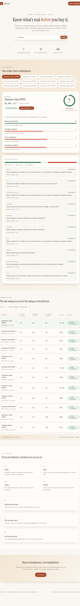

# Safe-Pro — setup & run guide

Safe-Pro compares beauty products across **Amazon, Flipkart, and Myntra**, detects fake reviews with a trained ML model, and shows a trust score per product.

- **Backend**: Django + DRF (`/api/search?q=...`). Scraping runs in a **background thread**, so the API answers instantly and the frontend polls until results are ready. Results are cached 24h.
- **ML**: a Random Forest (TF-IDF + review statistics) trained on the CMU Deceptive Opinion Spam corpus, blended with rule-based heuristics in `products/nlp.py`. Model artifact: `products/ml/fake_review_model.joblib`.
- **Frontend**: React + Vite (`frontend/`).


## Demo video

<video src="https://raw.githubusercontent.com/sanjayksanthosh/safepro/master/docs/video/safepro-brag.mp4" poster="https://raw.githubusercontent.com/sanjayksanthosh/safepro/master/docs/video/safepro-brag.jpg" controls width="100%"></video>

[Download the MP4](docs/video/safepro-brag.mp4) · [Poster](docs/video/safepro-brag.jpg)

## Screenshots

| Home | Search results |
| --- | --- |
|  |  |

## 1. Install requirements

Python 3.10+ and Node 18+.

```bash
python -m venv venv
venv\Scripts\activate                # Windows
pip install -r requirements.txt
python -c "import nltk; nltk.download('vader_lexicon')"
playwright install chromium
```

## 2. Set up the database

```bash
python manage.py migrate
```

Creates `db.sqlite3` — no separate database install needed.

## 3. Run the backend

```bash
python manage.py runserver 8000
```

First search for a term returns `{ "processing": true }` immediately; polling the same URL returns the ranked results once the background scrape + analysis finishes. Re-searching within 24h returns `cached: true` instantly.

## 4. Run the frontend

```bash
cd frontend
npm install
npm run dev
```

Open `http://localhost:5173`. The Vite dev server proxies `/api` to `http://127.0.0.1:8000`.

## Configuration (env vars)

| Variable | Default | Purpose |
| --- | --- | --- |
| `DJANGO_SECRET_KEY` | dev key | set a real one in production |
| `DJANGO_DEBUG` | `1` | set `0` in production |
| `DJANGO_ALLOWED_HOSTS` | `127.0.0.1,localhost` | comma-separated |
| `DJANGO_DB_ENGINE/NAME/USER/PASSWORD/HOST/PORT` | sqlite3 | optional PostgreSQL/MySQL |
| `SAFEPRO_DEMO` | unset | `1` uses a fake-data generator instead of live scraping (offline dev) |

## Project layout

```
safepro/
├── manage.py
├── requirements.txt
├── safepro_backend/       Django settings (env-configured) & URL routing
├── products/
│   ├── models.py          SearchQuery (with job status), Product, Review
│   ├── views.py           /api/search (async + polling), /api/products/<id>/
│   ├── scraper.py         demo/real switch, orchestrates the three sites
│   ├── scraper_playwright.py   live Playwright scrapers (Amazon/Flipkart/Myntra)
│   ├── nlp.py             VADER sentiment + fake-review blend + trust score
│   ├── ml/
│   │   ├── features.py    feature extraction shared by training & inference
│   │   ├── model.py       pipeline builder, model loader, predictor
│   │   └── fake_review_model.joblib
│   └── urls.py
├── train_model.py         dataset download + train + evaluate + save
├── data/op_spam_v1.4      CMU Deceptive Opinion Spam corpus
└── frontend/              React + Vite app (src/App.jsx)
```

## How the async scraping works

1. `GET /api/search?q=...` — if a fresh cached result exists, return it (`cached: true`).
2. Otherwise mark the `SearchQuery` row `pending` and start a daemon thread that scrapes all three sites, analyzes reviews, and saves products.
3. The API returns `{ "processing": true }`; the frontend polls until it sees `results`.
4. Failures set `status: error` with the message; retried on next search.

## ML training

`train_model.py` downloads the CMU corpus (1,600 hotel reviews), extracts `review_features()` (TF-IDF + length/punctuation/shouting statistics), trains a 300-tree Random Forest with a scaled TF-IDF/statistic pipeline, and reports CV + holdout accuracy. Latest run: ~89% holdout accuracy. It is blended with the rule-based heuristic in `nlp.py` (`MODEL_WEIGHT=0.4`) because model probabilities compress on real cosmetic reviews (domain shift from hotels).

## Tests

```bash
python manage.py test products
```

17 tests cover the NLP pipeline in `products/nlp.py` (`clean_text`, sentiment,
`_has_repetition`, `fake_probability`, `analyze_reviews`, `compute_trust_score`),
run without a database (`SimpleTestCase`) and with the ML model mocked out so they
are deterministic.

## Notes / caveats

- Scraping selectors change and sites throttle/captcha — individual runs can come back partial or empty; results are cached 24h per term.
- Myntra requires a headed browser (`--disable-http2`) because headless fails with HTTP/2 errors.
- Flipkart reviews are read from the dedicated `/product-reviews/{pid}` page, not the product page.
- `logs/safepro.log` captures structured logging.

## Deploying (free hosting)

The repo is Docker-ready (`Dockerfile`, `start.sh`, `render.yaml`). The image
builds the React app, installs Python + Playwright Chromium + system libs, runs
migrations, and starts Gunicorn (1 worker, 8 threads — required because the
in-flight job lock and progress live in process memory).

Important: live scraping needs a real browser (Playwright Chromium), so
"run Python only" free hosts (PythonAnywhere, most serverless) won't work.

### Option A — Render (free tier, easiest)

1. Push this repo to GitHub.
2. On [render.com](https://render.com) → **New +** → **Blueprint** → connect the repo.
   It picks up `render.yaml` automatically. Or **New + Web Service** → choose Docker,
   and set the env vars from the table below.
3. Deploy. First request after idle takes ~1 min to cold-start (free tier
   sleeps after 15 min of inactivity). Cached results (SQLite) reset on
   redeploy since the free disk is ephemeral.

### Option B — Oracle Cloud Always Free (most robust, real server)

Create a free ARM VM (4 cores / 24 GB), then on the VM:

```bash
sudo apt update && sudo apt install -y git python3-venv chromium
git clone <your-repo-url> && cd <repo>
python3 -m venv venv && source venv/bin/activate
pip install -r requirements.txt
python -m playwright install chromium
sudo python -m playwright install-deps chromium      # OS libs for Chromium
python -c "import nltk; nltk.download('vader_lexicon')"
python manage.py migrate
python manage.py collectstatic --noinput
# env vars, then run behind nginx with:
DJANGO_DEBUG=0 DJANGO_ALLOWED_HOSTS=<your-ip-or-domain> DJANGO_SECRET_KEY=<secret> \
  gunicorn safepro_backend.wsgi:application --workers 1 --threads 8 --timeout 180 \
  --bind 0.0.0.0:8000
```

### Required env vars (all platforms)

| Variable | Example | Purpose |
| --- | --- | --- |
| `DJANGO_DEBUG` | `0` | must be `0` in production |
| `DJANGO_SECRET_KEY` | random string | session/signing secret |
| `DJANGO_ALLOWED_HOSTS` | `*` or your domain | allowed host header |

Optional: `DJANGO_DB_*` to switch from SQLite to PostgreSQL/MySQL.

Notes on free hosting:
- Render free tier sleeps when idle and has ~512 MB RAM — fine for this app
  (Chromium launches only during a scrape). SQLite cache resets on redeploy.
- A full scrape takes ~2 min on a normal server; results are cached 24h.

